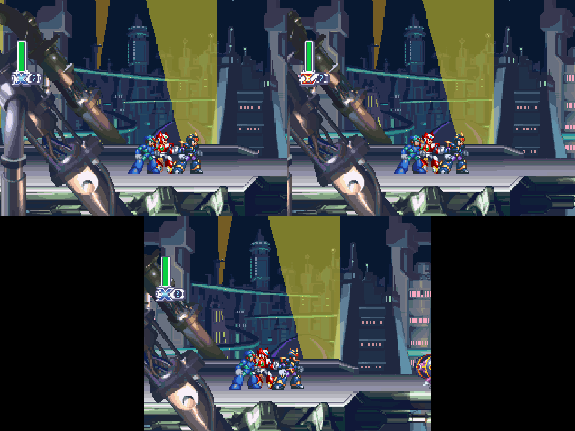
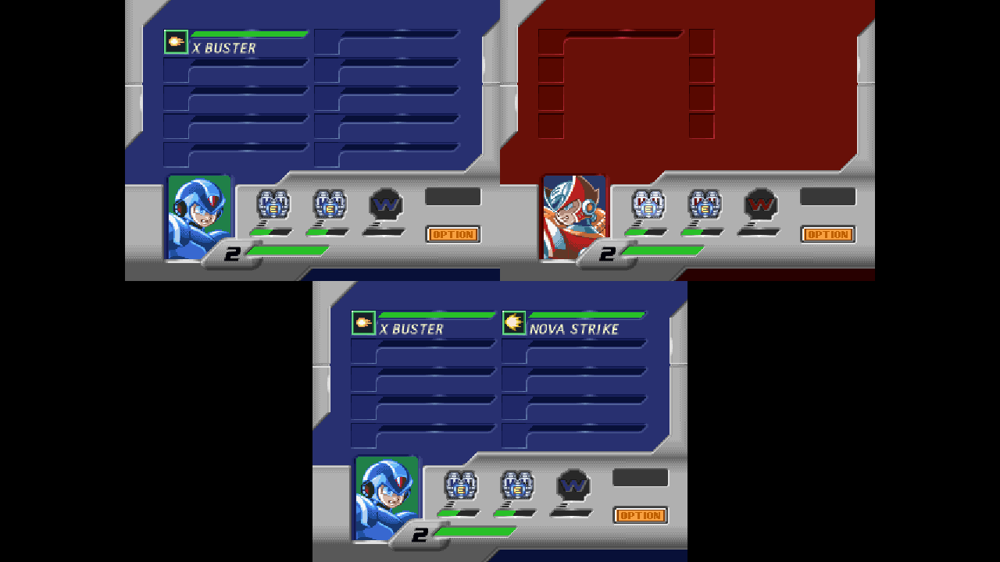

# Centered three-player split

The three-seat layout in Four Player Co-op now uses three 4:3 panes on its
existing 8:6 canvas. P1 and P2 occupy the top row; P3 is centered below them,
with black pillars on either side. Four-player play retains its 2x2 grid.
This work belongs only to the experimental feature branches.

The framework captures exactly three restored draw-only views and publishes
them atomically. Shared menus, movies, and unavailable-private-view fallback
use the same three-pane placement and fresh canonical images. P3 no longer
uses two half-captures, a wider placement/culling area, or special menu/HUD
offsets. All seats use the same native-width world and personal-menu draw.

Validation on 2026-10-24:

- `local_multiplayer_layout_test`: passed native and odd-sized canvas
  placement, centered P3 pillars, unchanged two-player and four-player geometry.
- `render_pass_sandbox_test`: passed exactly three captures from one common
  checkpoint, each declined seat, third-seat capture failure, complete-frame
  retention, simulation restoration, offline-only refusal, and recovery.
- `render_pass_abort_test`: passed third-seat watchdog unwind, restored live
  state and closed local-view scope, complete-frame retention, and recovery;
  existing pair and fourth-seat watchdog regressions also passed.
- Production compiler flags: both `gpu_gl_renderer.c` and
  `mmx4_coop_plugin.c` passed syntax checking with debug tools disabled.

Native Windows integration QA also passed with feature source `b672ed4`,
framework `2f3f384` and the development executable SHA256
`f6ae5f45f8f81b061d56703ba4f8d8c4d66e4255c804fd61b5b06ff24b17e47c`:

- Original USA retail code booted through normal controller navigation.
  Three distinct keyboard mappings moved the three living players
  independently through the runtime's normal SDL input path. P3 led with
  an independent camera while the other players remained in place.
- Eight composed PNGs passed pixel checks: each pane contains a live image;
  P3 has the same 4:3 dimensions as P1/P2, centered with completely black
  pillars. This passed at 960x720 and after resizing the window to 1280x720.
- X, Zero and Ultimate Armor X opened their matching private pause screens.
  Every player's menu cursor moved independently; pause/resume succeeded.
- Explicit draw-pass refusal produced a fresh shared fallback in the same
  three-pane geometry. Normal independent views recovered afterward.
- All three background layers rendered. The published frame had mode 4 and
  staged mask 7; 1,872 render-pass verification checks completed with zero
  mismatch, abort, watchdog or VRAM leak.
- Actual recomp-ui captures showed only **Local cameras: Split screen**
  offline, only **Online cameras: Individual** in the online context, and
  the local option again after returning through the dashboard.

The movement/controller probe used a declared offline native damage-grace
fixture to isolate input ownership. It does not qualify death or door
mechanics. These are bounded Windows development-build presentation checks,
not timing benchmarks or an exhaustive stage audit. Production archive
qualification is recorded separately. Earlier wide-bottom three-player
screenshots and reports document the previous layout only.
